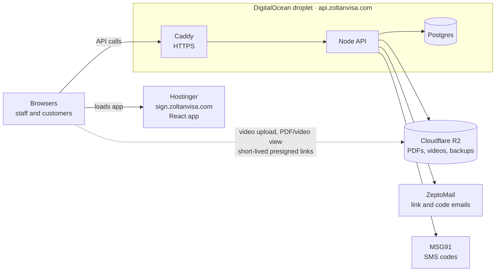
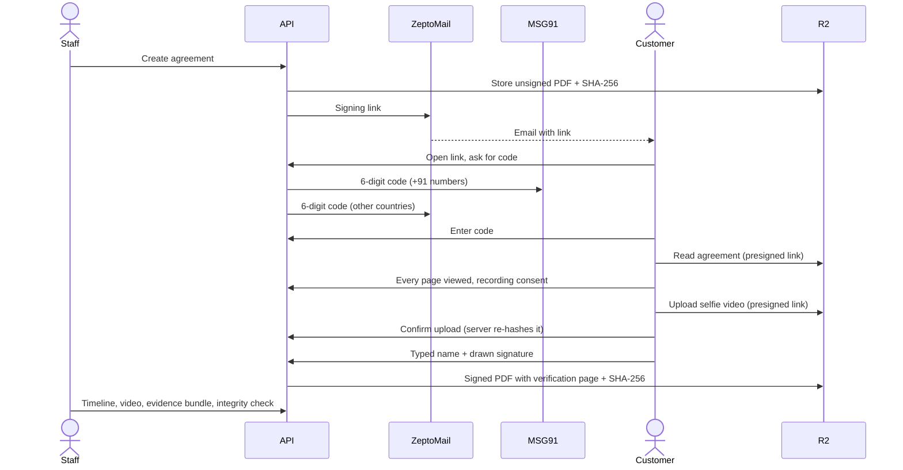

# Zoltan Visa: agreement signing with selfie-video proof

Staff email a customer an agreement link. The customer confirms it's them with a one-time code
(by SMS for Indian numbers, by email otherwise), reads the agreement, consents to a short
recording, records a selfie video confirming it, and signs. The system keeps the signed PDF, the
video and a tamper-evident audit trail, so Zoltan can prove later who signed what, and when.

| Path              | What                                                                                       |
| ----------------- | ------------------------------------------------------------------------------------------ |
| `apps/api`        | Express + Prisma API (`/api/v1`), runs on a DigitalOcean droplet                           |
| `apps/web`        | React app: customer signing flow (`/sign/:token`) and staff dashboard, hosted on Hostinger |
| `packages/shared` | zod schemas, shared types and the **legal wording**                                        |
| `deploy/`         | Caddy config (droplet) and `.htaccess` template (Hostinger)                                |

## Contents

1. [How it fits together](#how-it-fits-together)
2. [Run it locally](#run-it-locally)
3. [Configuration](#configuration)
4. [How it works](#how-it-works)
5. [Security and privacy](#security-and-privacy)
6. [Deploying](#deploying)
7. [Backups](#backups)
8. [Running costs](#running-costs)
9. [Tests](#tests)
10. [Editing legal text and templates](#editing-legal-text-and-templates)
11. [Known limits](#known-limits)

## How it fits together





## Run it locally

Requires **Node 24** (see `.nvmrc`), plus Postgres 16 and S3-style storage (MinIO). Docker
provides both with one command. Without Docker, use Homebrew (below).

```bash
cp .env.example .env          # set JWT_SECRET, SIGNING_SESSION_SECRET (openssl rand -base64 48) and SEED_ADMIN_PASSWORD
npm install
docker compose up -d          # Postgres :5432, MinIO :9000 (console :9001) with a private, encrypted bucket
npm run db:deploy             # applies apps/api/prisma/migrations
npm run db:seed               # first admin (SEED_ADMIN_*) and the default agreement template
npm run dev                   # API :4000 and web :5173 (Vite proxies /api to the API)
```

<details>
<summary>Without Docker (Homebrew)</summary>

```bash
brew install postgresql@16 minio minio-mc
brew services start postgresql@16
"$(brew --prefix postgresql@16)/bin/psql" postgres -c "CREATE ROLE app LOGIN PASSWORD 'app' CREATEDB;" -c "CREATE DATABASE agreements OWNER app;"
# In a separate terminal, leave running. The key is the dev-only one from docker-compose.yml; always reuse it.
mkdir -p ~/minio-data && MINIO_ROOT_USER=minioadmin MINIO_ROOT_PASSWORD=minioadmin MINIO_KMS_SECRET_KEY="dev-key:MUz6kCw04LfDehhpreLHbnYGbhXrUSHug94rUCZLr14=" minio server ~/minio-data --console-address :9001
# Once:
mc alias set local http://localhost:9000 minioadmin minioadmin
mc mb --ignore-existing local/agreements && mc anonymous set none local/agreements && mc encrypt set sse-s3 local/agreements
```

Then continue from `npm run db:deploy` above.

</details>

Open http://localhost:5173 and sign in as the seeded admin. Create an agreement with your own
email. In development nothing is really sent: the email (with the signing link) and the
one-time code are printed to the API log. Look for `[ConsoleProvider]`.

The camera and `crypto.subtle` only work on `localhost` or HTTPS. To try the signing flow on a
phone, expose port 5173 through an HTTPS tunnel.

| Script                                  | What                                                            |
| --------------------------------------- | --------------------------------------------------------------- |
| `npm run dev`                           | API (watch mode) and web together                               |
| `npm test`                              | API and web unit tests                                          |
| `npm run test:integration -w apps/api`  | Tests against the real Postgres and MinIO (see [Tests](#tests)) |
| `npm run lint` / `typecheck` / `format` | ESLint, TypeScript, Prettier                                    |
| `npm run db:migrate` / `db:deploy`      | Create-and-apply (dev) / apply only migrations                  |
| `npm run db:seed`                       | Create the first admin and default template (idempotent)        |

## Configuration

All settings are environment variables: `.env` at the repo root, see `.env.example` for every
value and its production setting. The API checks them at startup and refuses to start, naming
the problem, if something is missing or invalid.

| Variable                                                  | Production value                                                | Notes                                                                           |
| --------------------------------------------------------- | --------------------------------------------------------------- | ------------------------------------------------------------------------------- |
| `WEB_URL` / `API_URL`                                     | `https://sign.zoltanvisa.com` / `https://api.zoltanvisa.com`    | `WEB_URL` builds signing links and is the only allowed CORS origin              |
| `COOKIE_DOMAIN`                                           | `.zoltanvisa.com`                                               | Shares the staff login cookie between `sign.` and `api.`                        |
| `API_DOMAIN`                                              | `api.zoltanvisa.com`                                            | Caddy's HTTPS certificate name                                                  |
| `POSTGRES_PASSWORD`                                       | random, letters and digits only                                 | Droplet only. `DATABASE_URL` is then set by compose                             |
| `JWT_SECRET`, `SIGNING_SESSION_SECRET`                    | `openssl rand -base64 48` each                                  | Changing them signs everyone out                                                |
| `BUSINESS_NAME`                                           | `Zoltan Visa`                                                   | On emails, customer pages and PDFs                                              |
| `S3_ENDPOINT`, `S3_REGION`, `S3_SSE`                      | `https://<account-id>.r2.cloudflarestorage.com`, `auto`, `none` | Cloudflare R2                                                                   |
| `S3_BUCKET`, `S3_ACCESS_KEY`, `S3_SECRET_KEY`             | from R2                                                         |                                                                                 |
| `EMAIL_PROVIDER`, `ZEPTOMAIL_API_KEY`                     | `zeptomail`, from ZeptoMail                                     | `console` is refused in production                                              |
| `EMAIL_FROM`, `SUPPORT_EMAIL`                             | `noreply@gb.zoltanvisa.com`, `support@zoltanvisa.com`           | Sender must be on a ZeptoMail-verified domain                                   |
| `SMS_PROVIDER`, `MSG91_AUTH_KEY`, `MSG91_OTP_TEMPLATE_ID` | `msg91`, from MSG91                                             | Needed only when `SMS_COUNTRY_CODES` isn't empty                                |
| `SMS_COUNTRY_CODES`                                       | `+91`                                                           | Numbers starting with these get SMS codes; others get email. Empty = email only |
| `TOKEN_TTL_HOURS`                                         | `72`                                                            | Signing link lifetime                                                           |
| `RETENTION_YEARS`                                         | `3`                                                             | When records are flagged for deletion                                           |
| `DB_BACKUPS`, `BACKUP_RETENTION_DAYS`                     | `on` (set by compose), `30`                                     | Nightly database backup to R2                                                   |
| `TRUST_PROXY`                                             | `1` (Caddy)                                                     | Affects the IPs written to the audit trail                                      |

The web app has one build-time setting, `VITE_API_URL`, which the deploy workflow sets from the
`API_ORIGIN` repository variable.

## How it works

### 1. Staff create an agreement

**New agreement** takes the customer's name, mobile number (international format), email,
package (visa, travel or both), destination, price and currency, template and notes. The API:

1. Fills the template's `{{placeholders}}` (values are HTML-escaped) and renders an A4 PDF with
   headless Chrome. JavaScript is off and network access is blocked during rendering.
2. Stores the PDF at `agreements/{id}/original.pdf` and records its SHA-256.
3. Creates a signing token (32 random bytes). Only its SHA-256 is stored.
4. Emails the customer a branded "Review and sign" message with `{WEB_URL}/sign/{token}`
   through ZeptoMail. If sending fails, the agreement stays `DRAFT` and staff can resend.

Statuses: `DRAFT → SENT → OPENED → VERIFIED → SIGNED`, or `EXPIRED` / `CANCELLED`.

### 2. The customer signs (`/sign/:token`, public, mobile-first)

| Step    | What happens                                                                                                         | Audit event                                                             |
| ------- | -------------------------------------------------------------------------------------------------------------------- | ----------------------------------------------------------------------- |
| Landing | Zoltan logo, customer name, link expiry                                                                              | `OPENED` (first time only)                                              |
| Verify  | 6-digit code by SMS (`+91`) or email (other countries). 10 min expiry, 5 attempts, 60 s resend cooldown              | `OTP_SENT`, `OTP_FAILED`, `OTP_VERIFIED` (with channel and destination) |
| Read    | Plain-language summary plus the PDF (pdf.js). "I agree" unlocks once every page has been on screen                   | `AGREEMENT_VIEWED` (pages, seconds)                                     |
| Consent | Recording notice (mentions the DPDP Act, 2023) and checkbox                                                          | `RECORDING_CONSENT_GIVEN` (wording version)                             |
| Video   | Front camera, mirrored preview, script overlay, 3-2-1 countdown, 4–15 s, preview and retake. Uploaded straight to R2 | `VIDEO_RECORDED` (SHA-256)                                              |
| Sign    | Typed name, drawn signature, agree checkbox                                                                          | `SIGNED`                                                                |

Each event records the time, IP, browser and a coarse device fingerprint (screen, platform,
language, timezone). The server enforces the step order, so a customer can't sign without a
verified code, every page viewed, consent, and a confirmed video.

**Video upload:** the browser hashes the recording and asks for a 10-minute presigned upload link
that signs the exact `Content-Type` and `Content-Length`. It uploads with progress and automatic
retries. The server then checks that the object exists, its size matches and its SHA-256
(streamed) matches, before attaching it. If the camera is blocked, the customer sees how to allow
it on Android and iPhone. The step can't be skipped.

**Signed PDF:** the API re-checks the original PDF's hash, then appends a verification page. That
page shows:

- the signature and typed name
- how and when the code was verified (for example "SMS code to +9198…")
- the signing time in IST and UTC
- IP, browser and device
- the consent wording version
- the original PDF and video hashes, and the audit hash before signing

Every original page is stamped with a footer. The result's SHA-256 is stored on the agreement and
in the `SIGNED` event.

Expired, cancelled, already-signed and invalid links each show their own plain-language screen.

### 3. Evidence and integrity

- **Hash-chained audit trail:** each event stores
  `hash = SHA-256(prevHash + canonical JSON of the event)`, starting from 64 zeros, numbered by a
  per-agreement `seq`. A database trigger rejects `UPDATE`, `DELETE` and `TRUNCATE` on
  `AuditEvent`. The only exception is the admin purge described below.
- **Verify integrity** (agreement page): re-hashes every stored file, recomputes the chain, and
  checks the hashes on the agreement against those written into the audit events. Changing a
  file, an event, or a file together with its stored hash all make it fail, and it says which.
- **Evidence bundle** (ZIP): `original.pdf`, `signed.pdf`, the video, `audit-log.json`,
  `hashes.txt` (works with `sha256sum -c`) and a `README.txt` explaining how a third party can
  verify it.
- **Access log:** every video view, PDF view or download, bundle download, integrity check and
  purge records who did it and when.

### 4. Staff dashboard

- **List:** search by name, phone or ID; filter by status, package and date (IST); paginated.
- **Agreement page:** details, timeline, PDFs, video (loaded only on click), evidence bundle,
  integrity check, plus actions:
  - **Resend:** emails a new link. The old link and any open signing session stop working.
  - **Extend expiry:** an expired link returns to its previous status.
  - **Cancel:** takes an optional reason.
- **Admin only:**
  - **Users:** add, change role, reset password, deactivate. Changes take effect on the user's
    next request.
  - **Templates:** saving creates a new version and retires the previous one.
  - **Access log.**
  - **Retention:** the list of records due for deletion, with the purge action.

### 5. Scheduled jobs (inside the API process)

- Every 15 minutes, expired links are marked `EXPIRED`.
- Daily, signed, expired or cancelled agreements older than `RETENTION_YEARS` (from signing, or
  from creation if never signed) are flagged. **Nothing is deleted automatically.**
- Daily, with `DB_BACKUPS=on`, the database is backed up to R2. See [Backups](#backups).

## Security and privacy

- **Tokens:** signing tokens, codes and staff passwords are never stored in plain form. Tokens are
  stored as SHA-256 hashes, codes as an HMAC keyed with a secret, and passwords with argon2id.
  Secrets are compared in constant time.
- **Staff sessions:** an `httpOnly` cookie holding a JWT (8 h), shared across
  `.zoltanvisa.com`, with a double-submit CSRF token required on every write. The user is
  re-checked in the database on every request.
- **Customer sessions:** a 30-minute token, tied to the link it came from.
- **Rate limits:**

  | Scope                     | Limit                                                           |
  | ------------------------- | --------------------------------------------------------------- |
  | All public signing routes | 120 per minute per IP                                           |
  | Code sends                | 5 per link per hour, 10 per IP per hour                         |
  | Code checks               | 15 per link and 30 per IP per 15 minutes, plus 5 tries per code |
  | Staff sign-in             | 10 per 15 minutes                                               |
  | Signed-in routes          | 600 per minute per IP                                           |

- **Request checks:** helmet headers; CORS limited to `WEB_URL`; every input validated with zod.
  Logs never contain codes, tokens or presigned URLs.
- **Storage:** the R2 bucket is private (R2 always encrypts at rest) and every file access goes
  through a short-lived presigned URL (5–10 minutes).
- **Browser hardening:** Hostinger serves the app with a strict Content-Security-Policy and
  `Referrer-Policy: no-referrer`, so signing URLs never leak in a `Referer` header. Camera and
  microphone are allowed only for the app itself.
- **Consent:** the wording is versioned, and its version is stored with each agreement and event.
- **Deletion:** a customer can ask from `/privacy`, which opens an email to the privacy contact.
  An admin acts on it with **Purge**, which:
  - asks the admin to type the agreement ID
  - deletes the files, audit events and OTP records
  - blanks the customer's details
  - keeps a tombstone row and writes an access-log entry

  Migration `0003` lets audit rows be deleted only inside that purge transaction.

## Deploying

Do these in order. The code must be in a GitHub repository first. This folder isn't a git
repository yet: `git init`, commit, and push to a private GitHub repo.

### 1. Cloudflare R2 (files)

1. Cloudflare dashboard → **R2** → **Create bucket**, for example `zoltan-agreements`
   (location hint: Asia-Pacific). Leave public access **off**.
2. **R2 → Manage API tokens → Create API token**, with **Object Read & Write** on that bucket
   only. Copy the Access Key ID, Secret Access Key and the S3 endpoint
   (`https://<account-id>.r2.cloudflarestorage.com`).
3. Bucket → **Settings → CORS policy**. The browser reads PDFs and uploads videos directly, so add:

   ```json
   [
     {
       "AllowedOrigins": ["https://sign.zoltanvisa.com"],
       "AllowedMethods": ["GET", "PUT", "HEAD"],
       "AllowedHeaders": ["Content-Type"],
       "MaxAgeSeconds": 3600
     }
   ]
   ```

### 2. ZeptoMail (emails)

Zoltan already sends from `noreply@gb.zoltanvisa.com` through ZeptoMail. In ZeptoMail → **Mail
Agents**, create an agent for this app (or reuse one) and copy its **Send Mail token** into
`ZEPTOMAIL_API_KEY`. `EMAIL_FROM` must be on a domain verified in ZeptoMail. India-region
accounts use `api.zeptomail.in`, which is the default.

### 3. MSG91 and DLT (SMS codes for Indian numbers)

Every business SMS in India must be pre-registered (TRAI's DLT rules). This usually takes
1–2 weeks. Until it's done, set `SMS_COUNTRY_CODES=` (empty) and **every code goes by email**.
Nothing else needs to change.

1. On an operator DLT portal (Jio TrueConnect, Airtel, Vodafone Idea Vilpower, …), register
   Zoltan as a **Principal Entity**. Note the **Entity ID**.
2. Register a 6-letter **sender ID (header)**, for example `ZOLTAN`.
3. Register a **Service Implicit (OTP)** content template, for example:
   `{#var#} is your Zoltan Visa verification code. It is valid for 10 minutes. Do not share it with anyone.`
   Note the **DLT template ID**.
4. In MSG91, add the Entity ID and sender ID. Then create an SMS template with the same text,
   writing the code variable as `##otp##`, and attach the DLT template ID. Copy MSG91's
   **template ID** into `MSG91_OTP_TEMPLATE_ID` and your **auth key** into `MSG91_AUTH_KEY`.
5. Set `SMS_PROVIDER=msg91` and `SMS_COUNTRY_CODES=+91`, then send yourself one test code before
   going live.

### 4. DigitalOcean droplet (API and database)

1. Create a droplet: **Ubuntu 24.04**, **Basic, 2 GB / 1 vCPU**, region **Bangalore (BLR1)**,
   with your SSH key. Tick **Backups**.
2. **Networking → Firewalls:** allow inbound 22 (your IP only), 80 and 443, and attach it.
3. **DNS** (wherever `zoltanvisa.com` is managed, likely Hostinger hPanel → DNS Zone): add an
   `A` record `api` → the droplet's IP.
4. SSH in and install Docker: `curl -fsSL https://get.docker.com | sh`
5. Get the code: `git clone <your repo> /opt/agreements && cd /opt/agreements`. For a private
   repo, add a read-only deploy key.
6. `cp .env.example .env` and fill in the production values from
   [Configuration](#configuration). Set `NODE_ENV=production`, `S3_SSE=none`,
   `PUPPETEER_NO_SANDBOX=1` and a `POSTGRES_PASSWORD`.
7. Start it: `docker compose -f docker-compose.prod.yml up -d --build`. The API applies the
   migrations on start, and Caddy fetches the HTTPS certificate.
   - Check it with `curl https://api.zoltanvisa.com/health`.
   - Read logs with `docker compose -f docker-compose.prod.yml logs -f api`.
8. Create the first admin:
   `docker compose -f docker-compose.prod.yml run --rm api node_modules/.bin/tsx apps/api/prisma/seed.ts`

**Updating:** `git pull && docker compose -f docker-compose.prod.yml up -d --build`.

### 5. Hostinger (frontend)

1. hPanel → **Domains → Subdomains**: create `sign.zoltanvisa.com`. Turn on its free SSL and
   **Force HTTPS**.
2. hPanel → **Files → FTP Accounts**: create an FTP account whose directory is the subdomain's
   folder.
3. GitHub repo → **Settings → Secrets and variables → Actions**:
   - **Secrets:** `FTP_SERVER`, `FTP_USERNAME`, `FTP_PASSWORD`.
   - **Variables:**
     - `API_ORIGIN` = `https://api.zoltanvisa.com`
     - `S3_PUBLIC_ORIGIN` = `https://<account-id>.r2.cloudflarestorage.com`
     - optionally `FTP_SERVER_DIR`, if the FTP account's root isn't the subdomain folder
     - optionally `FTP_PROTOCOL=ftp`, if FTPS is refused
4. Push to `main`, or run **Deploy frontend to Hostinger** from the Actions tab. The workflow
   tests, builds with `VITE_API_URL`, writes `.htaccess` (page routing, security headers, CSP
   allowing the API and R2) and uploads `dist/`.

### 6. Check it end to end

Sign in at `https://sign.zoltanvisa.com`, create an agreement with your own email and phone, and
sign it on your phone. Then open it in the dashboard and run **Verify integrity**.

## Backups

- **Database:** with `DB_BACKUPS=on` (set in `docker-compose.prod.yml`), the API runs `pg_dump`
  daily and stores `backups/db-YYYY-MM-DD.dump` in the R2 bucket. It deletes backups older than
  `BACKUP_RETENTION_DAYS` (30). To restore, download a dump from R2 and run:

  ```bash
  docker compose -f docker-compose.prod.yml exec -T postgres pg_restore -U app -d agreements --clean --if-exists < db-2026-11-07.dump
  ```

- **Files** (PDFs, videos) live in R2, separate from the droplet.
- **Droplet:** DigitalOcean's weekly backups cover the whole server.

## Running costs

At about 100 agreements a month (check current prices on each provider's site):

| Item            | Cost                                                              |
| --------------- | ----------------------------------------------------------------- |
| Hostinger       | ₹0 extra (existing plan)                                          |
| Droplet, 2 GB   | $12/month                                                         |
| Droplet backups | $2.40/month                                                       |
| Cloudflare R2   | Free up to 10 GB (about 2,000–5,000 agreements), no download fees |
| ZeptoMail       | About ₹0.015 per email (₹150 per 10,000)                          |
| MSG91 SMS       | About ₹0.20–0.30 per code, including GST                          |
| **Total**       | **About $14.40/month fixed, plus about ₹0.30 per agreement**      |

DLT registration is a one-time cost, set by the operator portal.

## Tests

- `npm test`: 78 API tests (Supertest against the real routes and services, with an in-memory
  Prisma stand-in and mocked storage, email and SMS) and 5 web tests. They cover:
  - OTP rules, rate limits and SMS-versus-email routing
  - link states, step order and signing
  - video upload checks, integrity failures and the evidence bundle
  - admin rules, purge, the jobs and backups
  - the exact requests sent to ZeptoMail and MSG91
- `npm run test:integration -w apps/api`: runs against the Docker (or Homebrew) services after
  `npm run db:deploy`. It checks the audit trigger, the hash chain through real `jsonb`, and that
  storage rejects uploads not matching the signed type and size.

## Editing legal text and templates

- **Customer-facing legal wording** (agreement consent, recording notice, signature notice,
  privacy contact) is in [`packages/shared/src/legal.ts`](packages/shared/src/legal.ts). Change
  `LEGAL_TEXT_VERSION` with every edit: it's stored with each agreement as proof of what the
  customer saw.
- **Other customer copy** is in [`apps/web/src/sign/copy.ts`](apps/web/src/sign/copy.ts), kept in
  one place so a Hindi version can be added with react-i18next.
- **Emails** (signing link and code) are in [`apps/api/src/messaging/emails.ts`](apps/api/src/messaging/emails.ts).
- **Agreement templates** are edited by admins in the dashboard (Templates). The seeded starting
  point is [`apps/api/templates/default-agreement.html`](apps/api/templates/default-agreement.html).
  Placeholders: `businessName`, `customerName`, `customerPhone`, `customerEmail`, `packageType`,
  `destination`, `price`, `currency`, `notes`, `agreementId`, `date`.
- `/privacy` is a placeholder page. Replace it with the lawyer-approved policy.

## Known limits

- The MSG91 request format and R2's handling of presigned uploads have only been tested against
  mocks. Send one real code and upload one real video before go-live.
- The signed PDF isn't emailed to the customer automatically yet.
- English only for now. All copy is centralised for react-i18next.
- The API runs TypeScript through `tsx` in production, because the shared package is published
  as source.
- The PDF viewer renders every page up front, which suits agreements of a few pages.
