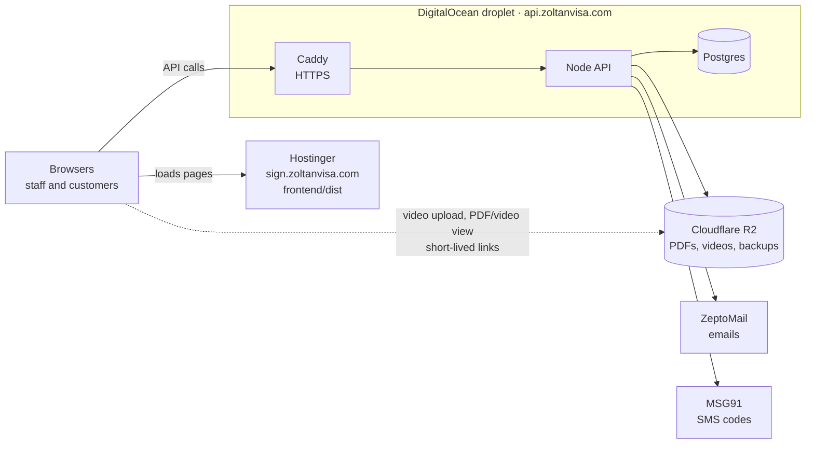

# Zoltan Visa: agreement signing with selfie-video proof

Staff email a customer an agreement link. The customer confirms it's them with a one-time code
(by SMS for Indian numbers, by email otherwise), reads Zoltan's Visa Assistance Agreement, ticks
the 10-point Client Declaration, records a short selfie video confirming it, and signs. The
system keeps the signed PDF, the video and a tamper-evident audit trail as proof.

Two separate apps, each with its own `package.json`, deployed on its own:

| Folder      | What                                                        | Runs on                                         |
| ----------- | ----------------------------------------------------------- | ----------------------------------------------- |
| `frontend/` | React app: customer signing pages and staff dashboard       | Hostinger, `sign.zoltanvisa.com` (static files) |
| `server/`   | Node API, Postgres database, nightly backups, HTTPS (Caddy) | DigitalOcean droplet, `api.zoltanvisa.com`      |

PDFs and videos are stored in **Cloudflare R2**. Emails go through **ZeptoMail**, and SMS codes
through **MSG91**.



## Contents

1. [Run it on your Mac](#run-it-on-your-mac)
2. [Values for a real test](#values-for-a-real-test)
3. [Deploy the server (DigitalOcean)](#deploy-the-server-digitalocean)
4. [Deploy the frontend (Hostinger)](#deploy-the-frontend-hostinger)
5. [Set up R2, ZeptoMail and MSG91](#set-up-r2-zeptomail-and-msg91)
6. [How it works](#how-it-works)
7. [Security and privacy](#security-and-privacy)
8. [Backups](#backups)
9. [Running costs](#running-costs)
10. [Tests](#tests)
11. [Editing the agreement and legal text](#editing-the-agreement-and-legal-text)
12. [Known limits](#known-limits)

## Run it on your Mac

You need **Node 24** (see `.nvmrc`), **Postgres 16** and **MinIO** (local stand-in for R2).

**One-time setup:**

```bash
brew install postgresql@16 minio minio-mc
brew services start postgresql@16
"$(brew --prefix postgresql@16)/bin/psql" postgres -c "CREATE ROLE app LOGIN PASSWORD 'app' CREATEDB;" -c "CREATE DATABASE agreements OWNER app;"
```

Start MinIO in its own terminal and leave it running. The key is the dev-only one from
`server/docker-compose.dev.yml`; always reuse it, or stored files become unreadable.

```bash
mkdir -p ~/minio-data && MINIO_ROOT_USER=minioadmin MINIO_ROOT_PASSWORD=minioadmin MINIO_KMS_SECRET_KEY="dev-key:MUz6kCw04LfDehhpreLHbnYGbhXrUSHug94rUCZLr14=" minio server ~/minio-data --console-address :9001
```

Then, once:

```bash
mc alias set local http://localhost:9000 minioadmin minioadmin
mc mb --ignore-existing local/agreements && mc anonymous set none local/agreements && mc encrypt set sse-s3 local/agreements

cd server
cp .env.example .env    # set JWT_SECRET, SIGNING_SESSION_SECRET (openssl rand -base64 48) and SEED_ADMIN_PASSWORD
npm install
npm run db:deploy       # create the tables
npm run db:seed         # first admin (SEED_ADMIN_*) and the Visa Assistance Agreement template

cd ../frontend
npm install
```

Docker users can run `docker compose -f server/docker-compose.dev.yml up -d` instead of
installing Postgres and MinIO.

**Every time:** with Postgres and MinIO running, use two terminals:

```bash
cd server && npm run dev      # API on http://localhost:4000
cd frontend && npm run dev    # open http://localhost:5173
```

Sign in with `SEED_ADMIN_EMAIL` and `SEED_ADMIN_PASSWORD` from `server/.env`. In development
nothing is really sent: the signing-link email and the code are printed in the **server**
terminal (look for `[ConsoleProvider]`).

## Values for a real test

To test the real flow (real email, real SMS, real storage), these are the values to fill in.

### `server/.env`

| Setting                                                   | Where it comes from                                                        | Example                                         |
| --------------------------------------------------------- | -------------------------------------------------------------------------- | ----------------------------------------------- |
| `NODE_ENV`                                                |                                                                            | `production` on the droplet                     |
| `WEB_URL`                                                 | The frontend's address                                                     | `https://sign.zoltanvisa.com`                   |
| `API_URL`                                                 | The server's address                                                       | `https://api.zoltanvisa.com`                    |
| `API_DOMAIN`                                              | Same host, for the HTTPS certificate                                       | `api.zoltanvisa.com`                            |
| `COOKIE_DOMAIN`                                           | Parent domain of both                                                      | `.zoltanvisa.com`                               |
| `POSTGRES_PASSWORD`                                       | Make one up: `openssl rand -hex 24`                                        | letters and digits only                         |
| `JWT_SECRET`, `SIGNING_SESSION_SECRET`                    | `openssl rand -base64 48`, once each                                       |                                                 |
| `BUSINESS_NAME`                                           |                                                                            | `Zoltan Visa`                                   |
| `S3_ENDPOINT`                                             | R2 → bucket → Settings → S3 API                                            | `https://<account-id>.r2.cloudflarestorage.com` |
| `S3_REGION`, `S3_SSE`                                     | Fixed for R2                                                               | `auto`, `none`                                  |
| `S3_BUCKET`                                               | Your R2 bucket name                                                        | `zoltan-agreements`                             |
| `S3_ACCESS_KEY`, `S3_SECRET_KEY`                          | R2 → Manage API tokens                                                     |                                                 |
| `EMAIL_PROVIDER`                                          |                                                                            | `zeptomail`                                     |
| `ZEPTOMAIL_API_KEY`                                       | ZeptoMail → Mail Agents → SMTP/API → Send Mail token                       |                                                 |
| `EMAIL_FROM`                                              | An address on a ZeptoMail-verified domain                                  | `noreply@gb.zoltanvisa.com`                     |
| `SUPPORT_EMAIL`                                           | Shown to customers, used as reply-to                                       | `support@zoltanvisa.com`                        |
| `SMS_COUNTRY_CODES`                                       | Empty = every code by email (until DLT is approved); `+91` = SMS for India | empty, later `+91`                              |
| `SMS_PROVIDER`, `MSG91_AUTH_KEY`, `MSG91_OTP_TEMPLATE_ID` | Only needed once `SMS_COUNTRY_CODES` is set: MSG91 dashboard               | `msg91`, …                                      |
| `PUPPETEER_NO_SANDBOX`                                    |                                                                            | `1` on the droplet                              |
| `SEED_ADMIN_EMAIL`, `SEED_ADMIN_PASSWORD`                 | Your real admin login, used once by the seed                               |                                                 |

`DATABASE_URL`, `TRUST_PROXY` and `DB_BACKUPS` are set by `server/docker-compose.yml` on the
droplet, so you don't need to fill them in there.

### `frontend/.env.production` (only used by `npm run build`)

| Setting               | Example                                                                 |
| --------------------- | ----------------------------------------------------------------------- |
| `VITE_API_URL`        | `https://api.zoltanvisa.com`                                            |
| `VITE_STORAGE_ORIGIN` | `https://<account-id>.r2.cloudflarestorage.com` (same as `S3_ENDPOINT`) |

**Trying real email from your Mac first:** in your local `server/.env`, set `EMAIL_PROVIDER=zeptomail`
and `ZEPTOMAIL_API_KEY`, and leave `SMS_COUNTRY_CODES` empty. Signing links and codes then arrive
in your real inbox, while everything else stays local.

## Deploy the server (DigitalOcean)

1. Create a droplet: **Ubuntu 24.04**, **Basic 2 GB / 1 vCPU** (about $12/month), region
   **Bangalore**, with your SSH key and **Backups** ticked.
2. **Networking → Firewalls:** allow inbound 22 (your IP only), 80 and 443.
3. **DNS** (Hostinger hPanel → Domains → DNS Zone for `zoltanvisa.com`): add an `A` record `api`
   pointing at the droplet's IP.
4. On the droplet:

   ```bash
   curl -fsSL https://get.docker.com | sh
   git clone <your GitHub repo> /opt/zoltan && cd /opt/zoltan/server
   cp .env.example .env && nano .env      # fill in the values above
   docker compose up -d --build           # API + Postgres + HTTPS; migrations run automatically
   docker compose run --rm api node_modules/.bin/tsx prisma/seed.ts   # first admin + agreement template
   curl https://api.zoltanvisa.com/health # → {"ok":true}
   ```

The database runs on the droplet itself (the `postgres` container, data in a Docker volume) and
is never exposed to the internet.

- **Update:** `cd /opt/zoltan && git pull && cd server && docker compose up -d --build`
- **Logs:** `docker compose logs -f api`

## Deploy the frontend (Hostinger)

1. hPanel → **Domains → Subdomains:** create `sign.zoltanvisa.com`, turn on its SSL, then
   **Force HTTPS**.
2. On your Mac:

   ```bash
   cd frontend
   cp .env.example .env.production    # fill in VITE_API_URL and VITE_STORAGE_ORIGIN
   npm run build                      # creates dist/, including .htaccess
   ```

3. hPanel → **Files → File Manager:** open the subdomain's folder and upload **everything inside
   `dist/`**, including the hidden `.htaccess` file and the `assets` folder. Replace the old files.

The `.htaccess` file makes page links work and adds the security headers. The build stops with an
error if either address is missing.

**Optional:** `.github/workflows/deploy-frontend.yml` does the build and upload on every push,
once you add the FTP secrets and the `API_ORIGIN` / `STORAGE_ORIGIN` variables in GitHub.

## Set up R2, ZeptoMail and MSG91

### Cloudflare R2 (files)

1. **R2 → Create bucket**, for example `zoltan-agreements`, with public access **off**.
2. **R2 → Manage API tokens → Create token:** Object Read & Write on that bucket. Copy the keys and
   the S3 endpoint.
3. Bucket → **Settings → CORS policy**:

   ```json
   [
     {
       "AllowedOrigins": ["https://sign.zoltanvisa.com"],
       "AllowedMethods": ["GET", "PUT", "HEAD"],
       "AllowedHeaders": ["Content-Type"],
       "MaxAgeSeconds": 3600
     }
   ]
   ```

### ZeptoMail (emails)

Zoltan already sends from `noreply@gb.zoltanvisa.com`. In ZeptoMail → **Mail Agents**, create or
reuse an agent and copy its **Send Mail token** into `ZEPTOMAIL_API_KEY`.

### MSG91 and DLT (SMS codes, India only)

Indian business SMS must be registered under TRAI's DLT rules first, which takes about 1–2
weeks. Until then, leave `SMS_COUNTRY_CODES` empty and every code goes by email.

1. On an operator DLT portal (Jio TrueConnect, Airtel, Vodafone Idea Vilpower…), register Zoltan as
   a **Principal Entity** and note the **Entity ID**.
2. Register a 6-letter **sender ID**, for example `ZOLTAN`.
3. Register a **Service Implicit (OTP)** template, for example
   `{#var#} is your Zoltan Visa verification code. It is valid for 10 minutes. Do not share it with anyone.`
4. In MSG91, add the Entity ID and sender ID, then create an SMS template with the same text,
   writing the variable as `##otp##`, and attach the DLT template ID. Copy MSG91's **template ID**
   and **auth key** into `server/.env`.
5. Set `SMS_PROVIDER=msg91` and `SMS_COUNTRY_CODES=+91`, then send yourself one code.

## How it works

1. **Staff create an agreement** with the customer's name, mobile number, email, package,
   destination, fee, template and notes. The server:
   - fills the template, with the creating staff member as "Zoltan Travel-Visas Representative"
   - renders it to PDF with headless Chrome and stores it with its SHA-256
   - creates a signing link (only a hash of it is stored) and emails it
2. **The customer** opens the link and:
   - confirms it's them with a 6-digit code (SMS for `+91`, email otherwise; 10 min, 5 tries,
     60 s between resends)
   - reads the agreement (the checkbox unlocks only after every page has been on screen)
   - consents to recording and records a 4–15 s selfie video, uploaded straight to R2 and
     checked by hash
   - ticks **each of the 10 Client Declaration statements**, types their name and draws a
     signature
3. **On signing**, a verification page is added to the PDF. It shows:
   - the signature, the 10 ticked declarations, and how and when the code was verified
   - the time in IST and UTC, IP, browser and device
   - the consent wording version, the file hashes and the audit hash

   Every original page gets a footer stamp. The signed PDF and its SHA-256 are stored.

4. **Staff** see a timeline of every event, play the video, view or download the PDFs, download
   an evidence ZIP, and run **Verify integrity**. That re-hashes every file and the hash-chained
   audit trail, so any change to a file, an event, or a file and its stored hash together is
   caught. Admins also manage users, templates, the access log and data deletion.
5. **Background jobs:**
   - every 15 minutes, expired links are marked expired
   - every day, records past `RETENTION_YEARS` are flagged for deletion (nothing is deleted
     automatically)
   - every night, the database is backed up to R2

## Security and privacy

- **Secrets at rest:** links, codes and passwords are never stored in plain form (SHA-256, HMAC,
  argon2id), and secrets are compared in constant time.
- **Staff login:** an `httpOnly` cookie shared across `.zoltanvisa.com`, with a CSRF token on
  every write. The user is re-checked in the database on every request.
- **Rate limits:**
  - code sends: 5 per link per hour
  - code checks: 15 per link per 15 minutes, plus 5 tries per code
  - public pages: 120 requests per minute
  - staff sign-in: 10 per 15 minutes
- **Requests:** CORS only allows `WEB_URL`, and every input is validated.
- **Logs** never contain codes, links or file URLs.
- **Files:** the bucket is private and encrypted at rest, and every file is accessed through a
  5–10 minute link.
- **Audit rows** are append-only, enforced by a database trigger. The only exception is an admin
  purge for deletion requests or retention, which the access log records.
- **Customer pages** set a strict Content-Security-Policy and never send the signing link in a
  `Referer` header.

## Backups

- **Database:** the API runs `pg_dump` every night into `backups/db-YYYY-MM-DD.dump` in R2 and
  keeps 30 days. To restore, download a dump from R2 and run, in `server/` on the droplet:

  ```bash
  docker compose exec -T postgres pg_restore -U app -d agreements --clean --if-exists < db-2026-11-07.dump
  ```

- **Files** live in R2, separate from the droplet.
- **The whole droplet** is covered by DigitalOcean's weekly backups.

## Running costs

At about 100 agreements a month (check current prices on each provider's site):

| Item                        | Cost                               |
| --------------------------- | ---------------------------------- |
| Hostinger                   | ₹0 extra (existing plan)           |
| Droplet, 2 GB, plus backups | about $14.40/month                 |
| Cloudflare R2               | free up to 10 GB, no download fees |
| ZeptoMail                   | about ₹0.015 per email             |
| MSG91 SMS                   | about ₹0.20–0.30 per code          |

## Tests

```bash
cd server && npm test                  # 80 tests: API routes, signing, OTP, video, integrity, admin, jobs, email/SMS providers
cd server && npm run test:integration  # 6 tests against the real Postgres and MinIO
cd frontend && npm test                # 5 tests: recording helpers
```

Also available in both folders: `npm run typecheck`, `npm run lint`, `npm run format`.

## Editing the agreement and legal text

- **Agreement wording:** admins edit it in the dashboard under **Templates**. Saving creates a new
  version, and existing agreements keep theirs. The starting point is
  [`server/templates/default-agreement.html`](server/templates/default-agreement.html), taken word
  for word from Zoltan's current paper agreement.
- **Declarations, consent and recording wording:** these are in `src/shared/legal.ts`. That
  folder exists in **both** `server/` and `frontend/`, so each app deploys on its own:
  - edit one copy and copy it to the other (a server test fails if they differ)
  - change `LEGAL_TEXT_VERSION` with every edit, because it's stored with each agreement as proof
    of what the customer saw
  - redeploy both apps
- **Other customer copy:** [`frontend/src/sign/copy.ts`](frontend/src/sign/copy.ts).
- **Emails:** [`server/src/messaging/emails.ts`](server/src/messaging/emails.ts).
- **Privacy page:** `/privacy` is a placeholder; replace it with the lawyer-approved policy.

## Known limits

- Real ZeptoMail, MSG91 and R2 haven't been tested yet. Send one real email, one SMS code and one
  video upload before going live.
- The paper agreement's full applicant-details form (passport number, date of birth, address,
  spouse, children, relatives) isn't collected. The agreement shows name, phone, email, service
  and fee.
- The agreement names the company as both "Zoltan Travel-Visas" and "Zoltan Global", exactly as
  in the paper version. Ask Zoltan which legal name to use.
- The signed PDF isn't emailed to the customer automatically yet.
- English only for now. Customer copy is centralised for adding Hindi later.
